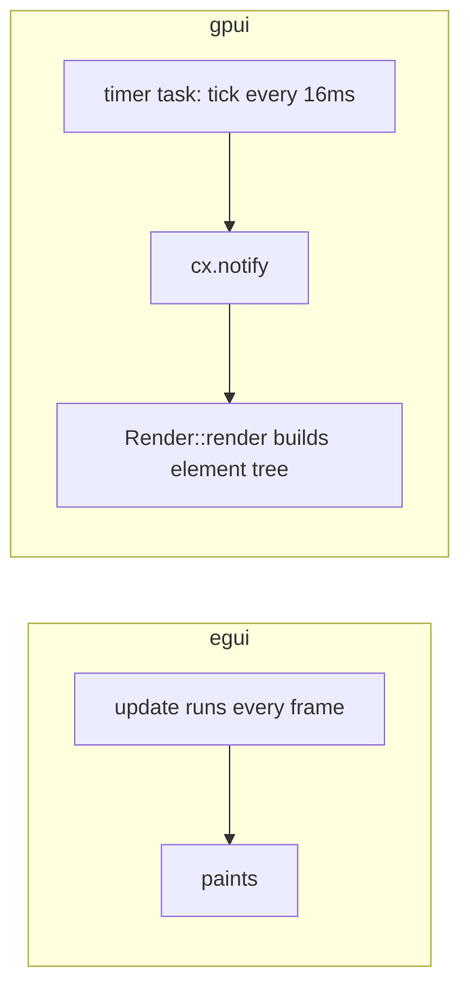

# Port: eframe/egui → gpui-kit

> **Status: done.** The app runs on `gpui-kit = "=0.8.0"`; `eframe` is gone.
> Headless UI tests (`src/tests/`) cover boot, pane selection, power-on with live
> LCD frames, and the metronome switch.
>
> What changed from the plan:
> - The firmware picker kept its search box: a `Combobox` instead of a plain menu.
> - The tempo readout is a themed `NumberInput` (−/+ steppers, typed entry), not the
>   LCD-styled DragValue.
> - Firmware combobox rows render through the delegate's `render_item` to keep the
>   file/SHA-256 tooltip; it draws its own ✓.
> - The sidebar takes a 32% width share (280–620 px) instead of egui's exact split.
> - The lockfile was regenerated: `test-support` pulled in `gpui-fast-*` crates whose
>   pins conflicted with the stale locked versions.
>
> Fixes after first real use: `RenderImage` uploads must be BGRA (RGBA swapped
> red/blue); card LCDs are square-fit so they can't spill; an in-app `TitleBar`
> supplies window controls where the compositor has none (GNOME); min window size
> 1024×700; the tick uploads only changed framebuffers, so an idle window renders
> ~2×/s; and `[profile.dev.package.fm1-*] opt-level = 3` keeps plain `cargo run` at
> realtime audio (unoptimized, the FM-1 core reaches only ~0.3x).

## The original plan

Replace the UI framework only. The emulator stack and the non-UI modules
(`emulator.rs`, `clock.rs`, `audio.rs`, `routing.rs`, `hardware.rs`, `midi_keys.rs`,
`affinity.rs`, `builtin.rs` — ~3,400 of 5,630 lines) stay untouched. The rewrite was
the ~2,200 lines of egui UI.

**Theme rule:** gpui-kit theme tokens everywhere. The only computed colour left is
the grid background (main colour of the selected screen, eased over 500 ms).

## Dependencies

- Removed `eframe = "0.33.3"`, added `gpui-kit = "=0.8.0"` — exact pin, since
  gpui-kit tracks Zed's fast-moving gpui snapshot.
- Kept `rfd`, `hqx`, `midir`, `cpal`, `libc`.
- Linux: gpui needs its own system packages (X11/Wayland dev libs).

## Architecture mapping

egui is immediate-mode (repaint every frame); gpui is retained (repaint only after
`cx.notify()`).

- `GridApp` keeps all non-UI state, minus every egui type.
- New `GridView` entity owns `Render` = window layout: grid column + sidebar over
  the transport bar.
- A `cx.spawn` loop (16 ms timer → `tick()` → `cx.notify()`) replaces
  `ctx.request_repaint_after`. `tick()` does the pre-paint work: held-key merge,
  LCD uploads, ghost refresh, LED decay, background-colour easing.

## Module by module

| Module | egui | gpui-kit |
|---|---|---|
| `main.rs` | `eframe::run_native` | `gpui_kit::application()` + `open_window` |
| `app.rs` | `App::update`, `TextureHandle`s | entity + `Render` + timer task; LCDs as `RenderImage` |
| `theme.rs` | custom palette and widgets | mostly deleted: kit components; keep colour-mix helpers |
| `keys.rs` | `egui::Key` tables | same tables as gpui keystroke strings |
| `grid.rs` | manual rects | card divs, `on_mouse_down`, border ring |
| `lcd.rs` | `ColorImage` | same pixel math, RGBA bytes into `RenderImage` |
| `sidebar.rs` | child `Ui`, `ComboBox` | `v_flex`, `Switch`, `Combobox`, `Scrollable` |
| `devices.rs` | rows, toggle, `ProgressBar` | `Switch` + `Button` + `Combobox` + `Progress` |
| `graph.rs` | `ScrollArea`, chips | `Scrollable` + `Button`/`Combobox` rows |
| `transport.rs` | `TopBottomPanel` | bottom bar div; tempo = `NumberInput` |
| `panel.rs` | painter rects | canvas element + hit-region divs |
| `firmware_picker.rs` | custom popup | deleted — `Combobox` has search |

## Input model

egui polls keys per frame; gpui delivers events.

- The root view tracks focus and keeps a `HashSet` of held keys; `tick()` merges it
  into `want[]` like the old `sync_held`.
- Text inputs consume their own keystrokes, so typing can't play notes.
- Window blur delivers no key-up for released keys → clear the held set on focus-out.
- Encoder keys (arrows, comma, period) call `turn_encoder` on key-down; OS key-repeat
  arrives as repeated events.

## Colour mapping

- Stays computed: the grid background only.
- Everything else uses theme tokens: card/background, foreground/muted, primary
  (selection ring), danger, border.
- Fixed by veto only: the FM-1 hardware colours (panel body, keycaps, LEDs, LCD
  green) depict the physical machine and stay fixed.

## LCD rendering (the perf risk)

`ImageSource::Render(Arc<RenderImage>)` takes CPU pixel buffers. Rebuild it when a
slot's pixels change; cards and sidebar render `img(source)` inside a bezel div.
Fallback if 60 Hz × 10 surfaces churned the image cache: `ImageSource::Custom` or a
quad `canvas`.

## Order of work

1. **Spike:** minimal window — one LCD at 60 Hz, eased background, one `Switch`.
2. **Skeleton:** layout regions + theme, `GridApp` ported.
3. **Read path:** cards, LCDs, power switch, firmware `Combobox`, status.
4. **Devices + graph:** switches, buttons, progress.
5. **Transport + panel:** canvas painting, click/wheel, held keys, tempo.
6. **Polish:** light/dark theme, tooltips, blur/repeat edge cases, README update.

Verification per phase: build, run, exercise the path (power a pane, play keys,
watch flash progress). No test suite existed; smoke = run the app.

## Risks

- LCD image swap at 60 Hz — de-risked first in the spike.
- Held-key edge cases (blur, OS repeat) — new code, nothing to copy from egui.
- gpui-kit churn — pinned exact; upgrades are a deliberate act.
