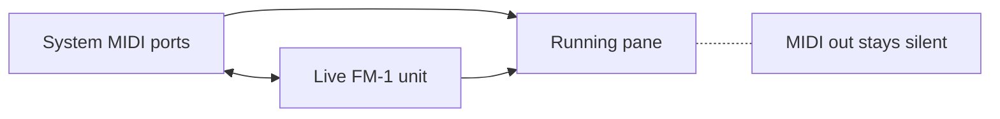

# FM-1 Grid

Four emulated M-VAVE FM-1s in a 2×2 grid, each with its own firmware and screen.
Built with gpui-kit.

Emulators start **off** — flip a pane's power switch in the sidebar to start it.
Click a pane to send your keyboard there; the selected card gets a colored border.

Grid cards show the screens at 1x (240×240), snapping to 0.5x when the window gets
small; the selected card's screen gets an NTSC-style filter. The selected pane's
screen also appears in the sidebar, hqx-upscaled 2x (4x on big windows). The
grid/sidebar split is draggable, with the sidebar kept wide enough for at least 1x.
The grid background follows the main colour of the selected screen (resampled once a
second, faded over 500 ms). The Devices tab has its own pill tabs on top, centered:
**Devices** (the live USB units) and **MIDI Graph**. The app remembers which one you
picked, like the main tab. Both lists scroll, and PageUp/PageDown/Home/End work
there like they do in the Library.

The large FM-1 front panel at the bottom of the Emulator tab mirrors the active pane:
click its keys and buttons, turn knobs with the −/+ ends, and watch its LEDs follow
the firmware. The computer keyboard plays the pane while that tab shows; a configured
MIDI keyboard forwards on any tab. The keyboard and controls follow the selected
theme: their colors are derived from the theme's background hue (the panel stays
dark, even in a light theme), a held key takes the theme's accent color, and the
button lights take the theme's warning color (success color for PLAY).

A running pane can be **pinned** (the toggle beside its firmware selector): its flash
contents — the device's settings and project data — are written to disk at power-off
and when the app quits, and come back at the next boot. Pinned panes restore at
startup (still powered off). The split position, selected tab (and Devices
section), selected pane, metronome tempo, Download All toggle, theme and appearance
override restore the same way. State lives in the com.fm1-grid
data directory (`~/.local/share/fm1-grid` on Linux).

The **Library** tab lists every firmware the app knows — the bundled set, files you
import, and (online) everything the
[FM-1 Firmware Hub](https://thefirmwarehub.com/) offers, downloadable in place. The
listing also folds in [fm1-editor.com's firmware page](https://fm1-editor.com/firmware/):
entries the hub lacks appear with their own links, and entries both sites carry get
the combined tags and the newer side's version and download. The filter box at the
top matches space-separated words, each a case-insensitive substring anywhere in a
firmware's name, version, tags, author or description — "f ll gro" finds Felucca.
Clicking a tag pill toggles that tag's words in the filter. Items remove (not
builtins), download with progress, and **Flash To…** a live unit (modal progress +
log) or a powered-off unpinned pane (boots it). The **Download All** toggle at the
bottom of the list downloads every offer in turn, including upgrades of bundled
firmwares; **Reload** beside it re-fetches both listings. Download All walks the
list from the top and moves past an item that fails (the item gets one retry when
you flip the toggle off and on, or reload). It is not a poll loop: a sweep runs when
you turn it on, when the online listing refreshes, and when a download finishes,
then it parks. Left on when you quit, it resumes when the app starts and the first
catalog lands. The bottom form imports a
firmware file with a name, version and description.


## Run

```sh
cargo run --release -p fm1-grid
```

With no arguments the panes load the embedded firmwares in list order. Any pane can
run any firmware the library has — pick it from the selector in the sidebar. On Linux
each running emulator is pinned to its own physical core while cores last. Four
emulators at once want four cores; power on only what you play.

Pass up to four firmware files to choose what loads where (left to right, top to
bottom):

```sh
cargo run --release -p fm1-grid -- sloop.fwsc felucca.fwsc
```

A `.fwsc` file is an update package; a `.bin` or `.xip` file is a raw app image.
`--help` lists all options.

### Firmware selector

The power toggle and selector for the selected pane sit in a row across the top of
the sidebar; the selector stretches to fill the row. The power control is a large
toggle button with a power icon. The slot number pill sits on its own at the bottom
right of the sidebar. The pane's status (errors, dropped frames, throughput) is on
the right of the metronome row. The selector only works while the pane is off —
hover it while the pane is on to see why. It is a searchable list of every firmware the
library has at hand — embedded, imported or downloaded — grouped by tag. Hovering a
choice shows its description; embedded entries also show the file name and SHA-256
hash. A new firmware boots the next time you power the pane on. To add a file of your
own, use the Library tab's import form.

The embedded list lives in `firmware/firmwares.json` and is compiled in at build time.
Manage it with the helper script, then rebuild:

```sh
scripts/firmware.sh add ~/Downloads/new-1.0.fwsc "New Firmware" 1.0
scripts/firmware.sh del "New Firmware"
scripts/firmware.sh list
```

`add` copies the package into `firmware/` and records its hash; `del` removes both.
The JSON order is the default pane order.

The `.fwsc` packages are gitignored; the build downloads and hash-verifies any missing
ones on first build, so a fresh clone just works.

## Keyboard

The selected pane gets these keys:

| Keys | FM-1 |
|------|------|
| `A W S E D F T G Y H U J K O L P ; '` | C4 … F5 (key IDs 21–38) |
| `C V B N M Q I` | F3, F#3, G3, G#3, A3, A#3, B3 (IDs 14–20) |
| `Z` / `X` | octave down / up (IDs 0, 1) |
| `1 2 3 4 5 6 7 8 9 0` | function buttons (IDs 2–11) |
| `Space` | PLAY / PAUSE (ID 12) |
| `R` | REC (ID 13) |
| `←` / `→` | PRESETS encoder −/+ |
| `↑` / `↓` | ALGORITHM encoder −/+ |
| `,` / `.` | SELECT encoder |

Switching panes releases held keys on the old one, so no note sticks. A powered-off
pane ignores keys.

## Devices

The Devices tab's first pill lists the live FM-1 units on USB. Each unit gets a big
name line — what it runs, plus the dim port facts — with the flash toggle and
firmware picker on their own row under it. Flash progress pins to the bottom of the
pane while the unit reboots through its loader.

The header's **Rescue** toggle adds every MIDI port on the system as a flash target,
next to the recognized units. That is for a unit so broken it no longer answers to
its FM-1 name (stuck in its update loader). If no FM-1 is found but some MIDI
device is out there, the toggle grows a warning ring.

## MIDI graph

The Devices tab's second pill is the MIDI graph, connecting sources to sinks: system
MIDI ports, running panes and live FM-1 units. Every MIDI out gets its own section,
always shown: the sinks it feeds are listed under its name, each with a small **X**
pill that removes the connection, and the section's **Connect** dropdown routes
another sink.



A running pane is a sink only. That is the emulator's limit: the FM-1's TRS jack is
MIDI-in alone, and the firmwares' real MIDI path is USB, which the emulated chip
cannot enumerate. The graph says so while such a pane runs.

## Settings

The gear icon at the bottom of the rail opens the Settings tab. One row holds the
**theme picker** — gpui-kit's built-in themes (Default, Ayu, Catppuccin, Solarized
and friends) plus the six FM-1 sets (Cream, Ember, Frost, Lavender, Mint,
Shadow) — growing to fill the row — and the
**appearance** selector: Auto (follows the OS), Light or Dark. Picks apply at once
and are saved with the rest of the app state. A dark-only theme keeps the default
light side, and vice versa.

## fm1-tty

A smaller version of the app that runs in a plain terminal. It talks to real FM-1
units over USB and has no emulators — a terminal can't draw their screens. It runs
the same fm1-performer core as the GUI app, so the library and flashing work the same
way.

```sh
cargo run --release -p fm1-tty
```

fm1-tty is its own crate and doesn't depend on the GUI stack at all: it builds about
150 crates where the GUI app builds about 550, so a clean build is much faster:

```sh
cargo build -p fm1-tty
```

The screen has four parts:

* **Devices** — the live FM-1 units on USB, one row each. `R` toggles **rescue
  mode**: every MIDI port on the system joins the list as a flash target, for a
  unit too broken to answer to its name. If no FM-1 is found but some MIDI device
  is, the block's title warns `R: RESCUE?`.
* **Library** — the firmware list, same as the GUI's Library tab: what came with the
  app, what you imported, and (online) what the Firmware Hub and fm1-editor.com
  offer.
  * `r` re-fetches the online listings.
  * `d` downloads the selected firmware.
  * `a` toggles **Download All**: every offer is downloaded in turn, one at a time,
    skipping items that fail (flip it off and on to retry them). The title shows
    `ALL` while it runs. It is not remembered between runs.
  * `f` flashes it onto a plugged-in FM-1 — with rescue mode on, onto any MIDI port
    (the picker flags those rows `RESCUE:`). With more than one target it asks which
    one. A pop-up shows progress; on failure it stays up until `Esc`.
* **Keyboard** — an on-screen piano. Click keys with the mouse, or press `Tab` to
  switch to it and use the same letter keys as the GUI. Every note goes to all
  plugged-in FM-1s at once. `m` picks a real MIDI keyboard — its notes light the
  piano and forward to the FM-1s too.
* **Metronome** — the same MIDI-clock beat as the GUI. `Space` starts and stops it,
  `-` and `+` nudge the tempo, `[` and `]` jump by ten. The light blinks on every
  beat, and every FM-1 follows the clock.

More keys: `Tab` moves between the library list and the piano. In the list, the arrow
keys (or `j` and `k`) move, `PageUp` and `PageDown` jump ten rows, and `Home` and
`End` go to the ends. `q` quits while the list is selected; `Ctrl-C` quits anywhere.

On terminals that support it (Windows Terminal, Ghostty, Konsole, WezTerm, …),
downloads drive the terminal's own progress bar (OSC 9;4) and library additions and
removals raise desktop notifications (OSC 9). Inside tmux these need
`allow-passthrough`.

## Metronome

Starts **off**; the rocker switch starts and stops it. While running it sends a MIDI
clock (24 PPQN) to every emulator, with MIDI Start/Stop on switch on/off. Tempo is
20–300 BPM — the −/+ steppers apply at once; a typed value is free-form while you
edit (a bad draft paints the field's error border) and applies on Enter or when the
field loses focus, clamped into range (unparsable text snaps back to the live tempo).
The small light blinks on every beat.

The clock runs on its own thread, independent of the window's frame rate, so timing
doesn't drift. Audio from all slots is mixed into one output stream; a stalled slot
can't block the others. Each card's status dot reports audio health from the trailing
five seconds of dropouts (green → yellow → orange → red) and hides again a second
after it recovers.

## Building

* Rust 1.91 or newer, stable.
* Linux: ALSA headers (`libasound2-dev` on Debian/Ubuntu) and the usual X11/Wayland
  dev packages for gpui.
* macOS/Windows: just the platform SDK.

`.cargo/config.toml` builds with `target-cpu=native` (this is a local tool) — delete
it if you build for another machine. The emulator crates are pinned to an fm1-emu
revision in `Cargo.toml`; bump the `rev` deliberately.

The firmware images are unmodified packages from
[The FM-1 Firmware Hub](https://thefirmwarehub.com/), M-VAVE and the firmware authors.
They keep their own licences: most are GPL-3.0, M-VAVE's FM1 Stock is Apache-2.0,
FM1 Open adds a linking exception, and FM-1+VA is proprietary. The emulator crates
are MIT. See `fm1-performer/firmware/README.md`.

## Layout

Three crates in one workspace: **fm1-performer** holds the UI-free machinery both
apps share, **fm1-grid** is the gpui-kit app, **fm1-tty** the terminal UI.

```
scripts/firmware.sh             add/del/list for the embedded firmware list
fm1-performer/build.rs          generates the embedded firmware table from firmware/firmwares.json
fm1-performer/firmware/         the embedded .fwsc packages plus firmwares.json
fm1-performer/src/emulator.rs   one thread + SoC + cores per slot, flash snapshot at exit
fm1-performer/src/audio.rs      the per-slot audio queue (the cpal output lives in fm1-grid)
fm1-performer/src/affinity.rs   Linux physical-core detection and per-emulator pinning
fm1-performer/src/hardware.rs   the USB-MIDI scanner and live-unit client
fm1-performer/src/usbmidi.rs    whether a firmware image advertises USB-MIDI
fm1-performer/src/routing.rs    the MIDI graph: sources, sinks, links
fm1-performer/src/clock.rs      MIDI-clock thread, tempo, beat light
fm1-performer/src/midi_keys.rs  a physical MIDI keyboard driving the virtual one
fm1-performer/src/library.rs    the firmware library: model, hub fetch/downloads, persistence
fm1-performer/src/download_heuristics.rs  listing link → package bytes: release/install page resolution, HTML rejection
fm1-performer/src/firmware_picker.rs  what a firmware pick installs or flashes (builtin, file, blob)
fm1-performer/src/store.rs      on-disk objects (JSON) and blobs (desktop dir / localStorage)
fm1-performer/src/builtin.rs    embedded firmware catalogue (generated table)
fm1-performer/src/keys.rs       keyboard layout and panel key tables
fm1-grid/src/app.rs             grid state: pane power, firmware install, key routing, LCD upload
fm1-grid/src/audio.rs           the four slot queues mixed into one output stream
fm1-grid/src/grid.rs            the 2x2 grid of cards (screens snap 1x/0.5x to fit) and the background colour
fm1-grid/src/sidebar.rs         the device sidebar: controls row on top, upscaled screen, pin
fm1-grid/src/devices.rs         the Devices tab's live USB unit rows and the Rescue toggle
fm1-grid/src/graph.rs           the Devices tab's MIDI graph editor
fm1-grid/src/panel.rs           the clickable FM-1 front panel (bottom of the Emulator tab)
fm1-grid/src/transport.rs       the bottom bar: the metronome row, global across tabs
fm1-grid/src/lcd.rs             RGB565 decode, colours, NTSC/ghost/hqx image filters
fm1-grid/src/theme.rs           the FM-1 hardware colours, the bundled theme catalog; chrome follows gpui-kit
fm1-grid/src/library_tab.rs     the Library tab's list, pills, actions and add-file form
fm1-grid/src/settings.rs        the Settings tab: theme picker, appearance override
fm1-grid/themes/                the bundled gpui-kit theme sets (upstream themes/ at the pinned tag)
fm1-grid/src/firmware_picker.rs the firmware dropdown's data (searchable, grouped by tag)
fm1-grid/src/flash_dialog.rs    the modal flash progress + message terminal
fm1-grid/src/session.rs         the saved UI state (split, tabs, pane, tempo, Download All)
fm1-grid/src/main.rs            startup, CLI firmware arguments, the quit hook saving pins
fm1-grid/src/tests/             headless UI smoke tests
fm1-tty/src/                    the terminal UI (ratatui): library + flashing, piano, metronome
```
