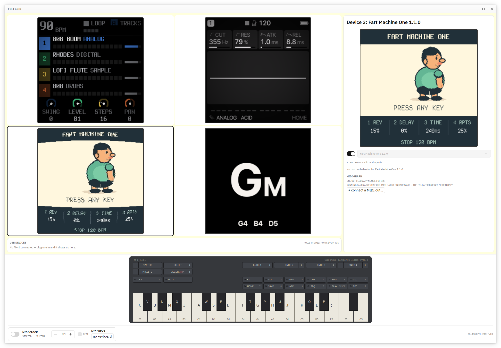
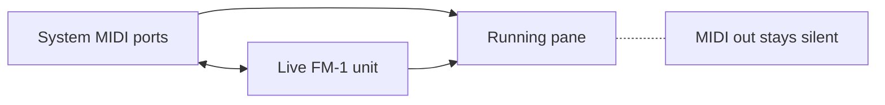

# FM-1 Grid

Four emulated M-VAVE FM-1s in a 2×2 grid, each with its own firmware and screen.
Built with gpui-kit.

Emulators start **off** — flip a pane's power switch in the sidebar to start it, so
idle panes cost nothing. Click a pane to send your keyboard there; the selected card
gets a blue border.

Grid cards always show the screen at 1x (240×240) with an NTSC-style filter. The
selected pane's live screen also appears in the sidebar, hqx-upscaled 2x (4x on big
windows); the grid/sidebar split is draggable, with the sidebar kept wide enough for
at least 1x. The grid background takes the main colour of the selected screen (updated
once a second, faded over 500 ms). The Devices tab splits the window evenly between
the live USB units and the MIDI graph.

The large FM-1 front panel above the metronome mirrors the active pane: click its keys
and buttons, turn knobs with the −/+ ends, and watch its LEDs follow the firmware.

A running pane can be **pinned** (the toggle beside its firmware selector): its flash
contents — the device's settings and project data — are written to disk at power-off
and when the app quits, and come back at the next boot. Pinned panes restore at
startup (still powered off). State lives in the com.fm1-grid data directory
(`~/.local/share/fm1-grid` on Linux).

The **Library** tab lists every firmware the app knows — the bundled set with the
hub's descriptions, files you import, and (online) everything the
[FM-1 Firmware Hub](https://thefirmwarehub.com/) offers, downloadable in place. Items
remove (not builtins), download with progress, and **Flash To…** a live unit (modal
progress + log) or a powered-off unpinned pane (boots it). The bottom form imports a
firmware file with a name, version and description.



## Run

```sh
cargo run --release
```

With no arguments, the four panes load:

| Pane | Firmware |
|------|----------|
| 1 | SLOOP 2.8 |
| 2 | Felucca 1.6.1 |
| 3 | FM1 Open V15 |
| 4 | ChoralRoot 0.26.1 |

Any pane can run any embedded firmware — pick it from the selector in the sidebar.
On Linux each running emulator is pinned to its own physical core while cores last.
Four emulators at once want four cores; power on only what you play.

Pass up to four firmware files to choose what loads where (left to right, top to
bottom):

```sh
cargo run --release -- sloop.fwsc felucca.fwsc
```

A `.fwsc` file is an update package; a `.bin` or `.xip` file is a raw app image.
`--help` lists all options.

### Firmware selector

The selector, power switch and status for the selected pane sit at the top of the
sidebar. The selector only works while the pane is off — hover it while the pane is
on to see why. It lists the embedded firmwares plus **Other…** (a file picker).
Hovering a choice shows its file name and SHA-256 hash. A new firmware boots the next
time you power the pane on.

The embedded list lives in `firmware/firmwares.json` and is compiled in at build time.
Manage it with the helper script, then rebuild:

```sh
scripts/firmware.sh add ~/Downloads/new-1.0.fwsc "New Firmware" 1.0
scripts/firmware.sh del "New Firmware"
scripts/firmware.sh list
```

`add` copies the package into `firmware/` and records its hash; `del` removes both.
The JSON order is the default pane order.

Run `cargo run --manifest-path firmware/download/Cargo.toml` before building to get the
embedded firmwares.

## Keyboard

The selected pane gets these keys:

| Keys | FM-1 |
|------|------|
| `A W S E D F T G Y H U J K O L P ; '` | C4 … F5 (key IDs 21–38) |
| `C V B N M Q I` | F3, F#3, G3, G#3, A3, A#3, B3 (IDs 14–20) |
| `Z` / `X` | octave down / up (IDs 0, 1) |
| `1 2 3 4 5 6 7 8 9 0` | function buttons (IDs 2–11) |
| `Space` | PLAY / PAUSE (ID 12) |
| `R` | REC (ID 13) |
| `←` / `→` | PRESETS encoder −/+ |
| `↑` / `↓` | ALGORITHM encoder −/+ |
| `,` / `.` | SELECT encoder |

Switching panes releases held keys on the old one, so no note sticks. A powered-off
pane ignores keys.

## MIDI graph

The Devices tab's MIDI graph connects sources to sinks: system MIDI ports, running
panes and live FM-1 units. Pick a source with **+ connect a MIDI out…**, then add
sinks with a row's **+**; click a chip to remove a connection.



A running pane is a sink only. That is the emulator's limit: the FM-1's TRS jack is
MIDI-in alone, and the firmwares' real MIDI path is USB, which the emulated chip
cannot enumerate. The graph says so while such a pane runs. (M-VAVE's own packages —
FM1 Open V15, FM-1+VA — are the bundled firmwares with no USB-MIDI at all.)

## Metronome

Starts **off**; the rocker switch starts and stops it. While running it sends a MIDI
clock (24 PPQN) to every emulator, with MIDI Start/Stop on switch on/off. Tempo is
20–300 BPM — the −/+ steppers apply at once; a typed value is free-form while you
edit (an invalid or out-of-range draft paints the field's error border) and applies
on Enter or when the field loses focus, clamped into range (unparsable text snaps
back to the live tempo). The small light blinks on every beat.

The clock thread runs independently of the window's frame rate, so timing never
drifts. Audio from all slots is mixed into one output stream; a stalled slot cannot
block the others. Each card's status dot reports its audio health from the trailing
five seconds of dropouts (green → yellow → orange → red); a healthy slot's dot hides
again a second after it recovers.

## Building

* Rust 1.91 or newer, stable.
* Linux: ALSA headers (`libasound2-dev` on Debian/Ubuntu) and the usual X11/Wayland
  dev packages for gpui.
* macOS/Windows: just the platform SDK.

`.cargo/config.toml` builds with `target-cpu=native` (this is a local tool) — delete
it if you build for another machine. The emulator crates are pinned to an fm1-emu
revision in `Cargo.toml`; bump the `rev` deliberately.

The firmware images are unmodified packages from
[The FM-1 Firmware Hub](https://thefirmwarehub.com/), M-VAVE and Baud Girl. They keep
their own licences: everything hub-mirrored is GPL-3.0, M-VAVE's FM-1_015 is
Apache-2.0, and FM-1+VA is proprietary. The emulator crates are MIT. See
`firmware/README.md`.

## Layout

```
build.rs             generates the embedded firmware table from firmware/firmwares.json
scripts/firmware.sh  add/del/list for the embedded firmware list
src/affinity.rs      Linux physical-core detection and per-emulator pinning
src/app.rs           grid state: pane power, firmware install, key routing, LCD upload
src/clock.rs         MIDI-clock thread, tempo, beat light
src/emulator.rs      one thread + SoC + cores per slot, flash snapshot at exit
src/audio.rs         four queues mixed into one output stream
src/builtin.rs       embedded firmware catalogue (generated table)
src/grid.rs          the 2x2 grid of cards (screens snap 1x/0.5x to fit) and the background colour
src/sidebar.rs       the device sidebar: heading, upscaled screen, pane controls, pin
src/panel.rs         the clickable FM-1 front panel
src/transport.rs     the bottom bar: panel plus metronome
src/lcd.rs           RGB565 decode, colours, NTSC/ghost/hqx image filters
src/keys.rs          keyboard layout and panel key tables
src/theme.rs         the FM-1 hardware colours; app chrome follows gpui-kit
src/store.rs         on-disk objects (JSON) and blobs (desktop dir / localStorage)
src/library.rs       the firmware library: model, hub fetch/downloads, persistence
src/library_tab.rs   the Library tab's list, pills, actions and add-file form
src/flash_dialog.rs  the modal flash progress + message terminal
src/main.rs          startup, CLI firmware arguments, the quit hook saving pins
src/tests/           headless UI smoke tests
firmware/            the embedded .fwsc packages plus firmwares.json
```
