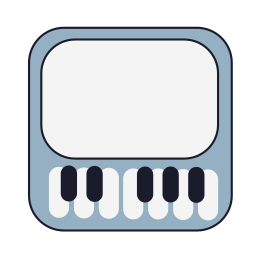
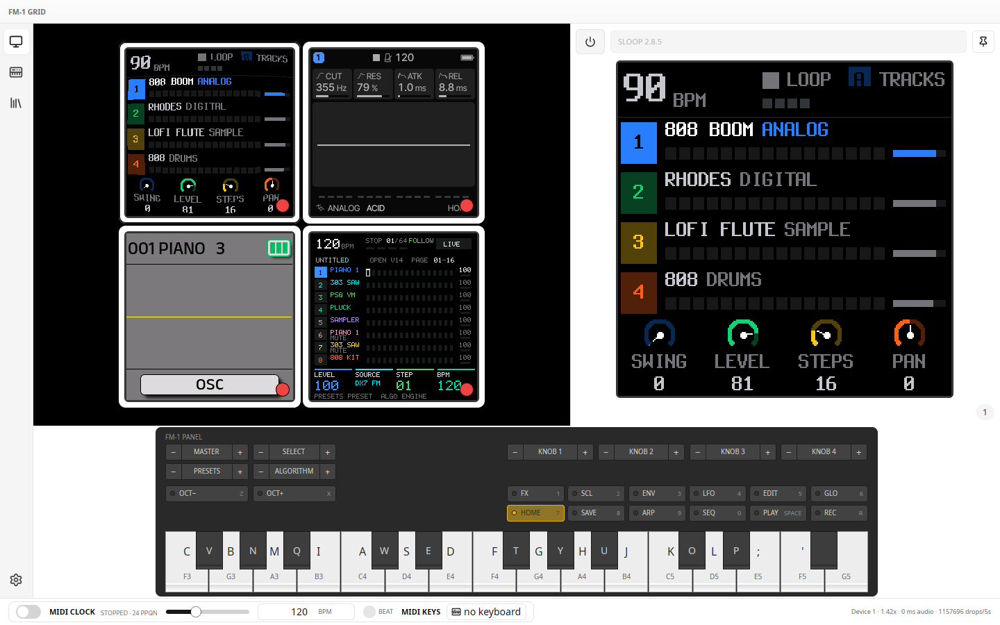
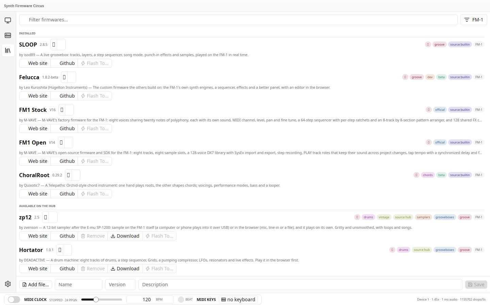
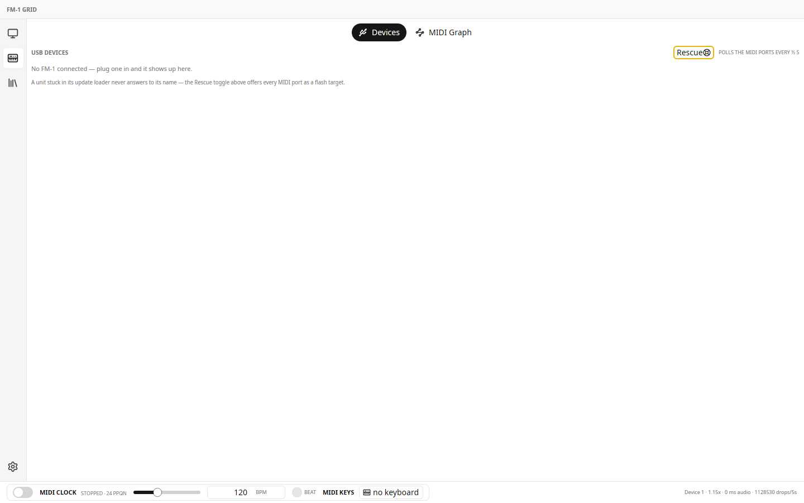
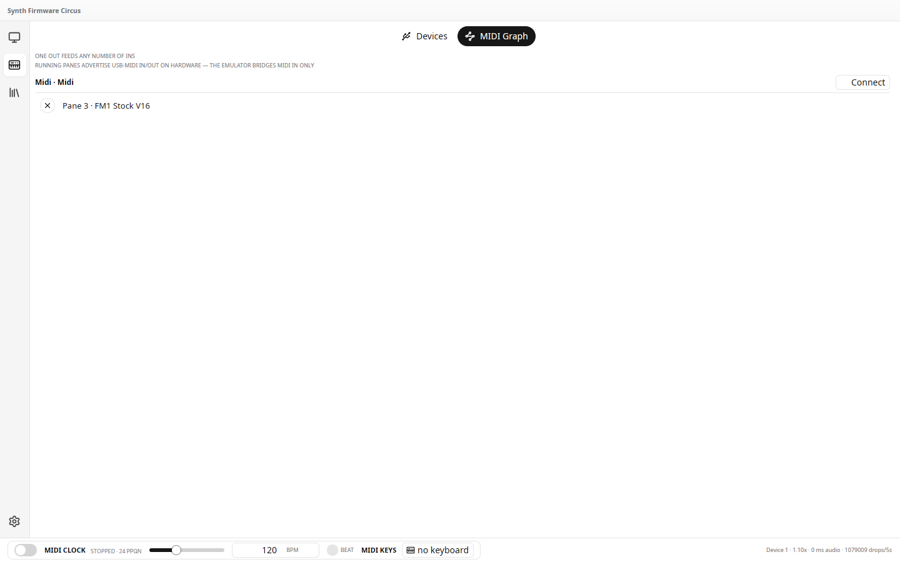
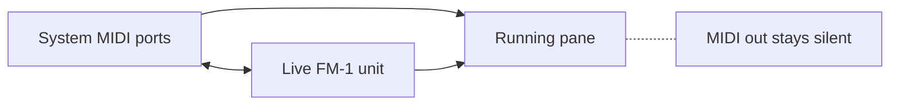
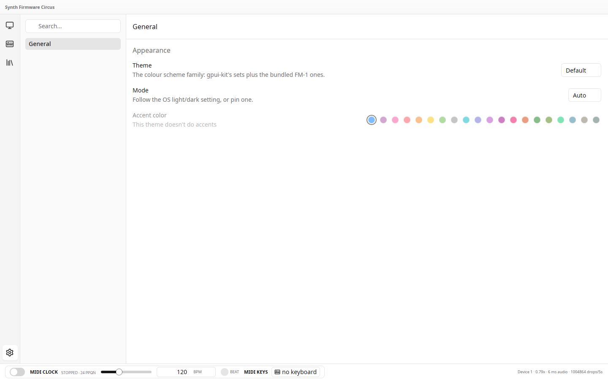
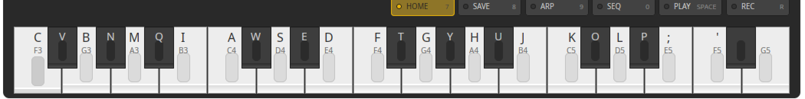

# FM-1 Grid



Four M-VAVE FM-1 synths in a 2×2 grid. Each pane has its own firmware and screen.
Built with gpui-kit.



## Run

```sh
cargo run --release -p fm1-grid
```

- Panes start off. Use the power button in the sidebar to start one.
- Click a pane to select it. Your computer keyboard then plays that pane.
- The sidebar shows the selected pane's screen, firmware picker and pin switch.
- Drag the divider between the grid and sidebar to resize them.
- Pick firmware while the pane is off. It starts the next time you power on.
- Pin a pane to save its flash data. Unpin it to forget the data.
- The app remembers your tabs, theme, split, pane firmware and pin choices.

## Emulator tab

- The grid shows each screen at 1x (240×240). Small windows use 0.5x.
- The selected card gets a slight fisheye bulge. Its screen also shows in the sidebar at 1x, 2x, 3x, 4x or 6x.
- The grid background follows the main color of the selected screen.
- The front panel is a working control surface. Click keys and buttons. Turn knobs with −/+ or the mouse wheel.
- The panel lights follow the firmware and your keyboard.

### Firmware picker

- Pick a firmware for the selected pane from the sidebar.
- The list is searchable and grouped by tag.
- Hover an item to see its description. Bundled items also show the file name and SHA-256 hash.
- The picker only works while the pane is off.
- Add your own file with the Library tab's import form.

The bundled list is in `firmware/firmwares.json`. Manage it with:

```sh
scripts/firmware.sh add ~/Downloads/new-1.0.fwsc "New Firmware" 1.0
scripts/firmware.sh del "New Firmware"
scripts/firmware.sh list
```

The `.fwsc` files are gitignored. A fresh build downloads and checks any missing ones.

### Metronome

- Starts off. The switch starts and stops it.
- Sends MIDI clock at 20–300 BPM.
- Drag the slider or use −/+. A typed tempo applies on Enter or focus loss.
- The light blinks on each beat. All running panes follow the clock.

## Library



- Lists bundled firmware, files you import, and online listings.
- Online sources: the FM-1 Firmware Hub, fm1-editor.com, Reverbose and mutant.cloud.
- Search box: all words must match the name, version, tags, author or description.
- Click a tag to add or remove it from the search.
- The **Devices** button shows All, FM-1, SMK-37 Pro, SMK-37 Elite or MKE-P37.
- The favorite button pins a row to the top. Its menu gives it a different glyph.
- **Download** gets an online firmware. **Download All** gets every offer the device filter shows.
- **Reload** fetches all online lists again.
- **Flash To…** sends a firmware to a live USB unit, or to an off pane.
- The bottom form imports a `.fwsc` file with a name, version and description. The package sets the device family and SMK model.

## Devices



- Lists live FM-1 units on USB.
- Each unit has a flash switch and firmware picker.
- Flash progress stays at the bottom while the unit reboots.
- **Rescue** adds every MIDI port as a flash target. Use it for a unit that no longer answers to its name.
- The emulator cannot run SMK-37 firmware. Those rows can only go to a live unit.
- A unit in ROM download mode shows its model, firmware and bootloader. With Rescue on, it can take m-bootloader. Download-mode discovery and flashing work on Linux, macOS and Windows; macOS needs sudo and an unmounted unit, and Windows needs administrator access.

## MIDI graph



- Open it from the **MIDI Graph** pill on the Devices tab.
- Every MIDI out has its own section. Its sinks are listed under it.
- **Connect** adds a sink. The **X** removes one.
- A running pane can be a sink, but not a source.
- The emulator's MIDI jack is input only. Real FM-1 units also have USB MIDI.



## Settings



- Click the gear in the left rail.
- The search box finds settings by name or keyword.
- **Theme** picks a color set: gpui-kit's Default, BeOS, Hot Dog Stand, Japanese Stationery and the computed accent families.
- **Influenza**, **Meltysand**, **Visualia**, **Mac Platinum** and **Very High Contrast** are built from the accent color.
- **Mode** follows the OS, or pins Light or Dark.
- **Accent color** only works for those computed themes.
- **Reset** puts the theme and mode back to their defaults.

## About

- The info icon at the bottom of the rail opens About.
- **About this app** shows the app title, version, release history, and a link to the GitHub repository.
- **Licenses** scrolls the generated third-party licence text.

## Keyboard

Click a pane to send your keys there.

| Keys | FM-1 |
|------|------|
| `A W S E D F T G Y H U J K O L P ; '` | C4 … F5 |
| `C V B N M Q I` | F3 … B3 |
| `Z` / `X` | octave down / up |
| `1`–`0` | function buttons |
| `Space` | PLAY / PAUSE |
| `R` | REC |
| `←` / `→` | PRESETS |
| `↑` / `↓` | ALGORITHM |
| `,` / `.` | SELECT |

- Switching panes releases held keys. A pane that is off ignores keys.
- The front panel keys, buttons and knobs also work with the mouse.
- White keys have a 2px lip and a shaded bottom strip. A pressed key shrinks its strip.
- Keys have a small membrane window near the top. It is slightly shaded when the key is up and glows with the accent when held. Button LEDs use warning yellow, and PLAY uses green.



## fm1-tty

A terminal version for real FM-1 units over USB. It has no emulators.

```sh
cargo run --release -p fm1-tty
```

- **Devices**: live USB units. `R` toggles rescue mode.
- **MIDI graph**: sources and their sink links. `Enter` removes a link or opens Connect.
- **Library**: the same firmware list. `/` filters, `v` picks a device, `d` downloads, `x` deletes, `a` downloads all, `f` flashes. The flash picker shows each unit’s USB path. Arrow, Page and Home/End keys in the filter jump back to the list.
- **Metronome**: `Space` starts and stops it. `-`/`+` change the tempo.
- `Tab` moves around. `q` quits. `Ctrl-C` quits from anywhere.
- It shares the library, tempo, device filter and Download All setting with the GUI.

## Build

- Needs Rust 1.91 or newer.
- Linux also needs ALSA headers and the usual X11/Wayland dev packages for gpui.
- macOS needs the Xcode command-line tools. Download-mode recovery needs sudo.
- The recovery build downloads m-bootloader v2.2 and its loader from the upstream release, verifies their SHA-256, and keeps them gitignored.
- Windows needs the MSVC build tools. Download-mode recovery needs administrator access.
- `.cargo/config.toml` uses `target-cpu=native`. Delete it when building for another machine.
- The emulator crates are pinned to a revision in `Cargo.toml`. Bump it on purpose.

Cross-build for a DevTerm A04:

```sh
scripts/deploy-devterm.sh
scripts/deploy-devterm.sh fm1-tty
```

The script needs podman. Set `DEVTERM_HOST` or `DEVTERM_PASS` to use another host or a password.

The bundled firmware keeps its own license. See `fm1-firmware/firmware/README.md`.

## Screenshots

```sh
scripts/screenshots.sh
```

This builds the app, then uses Xvfb, xdotool and ImageMagick to capture every image at 1440×900.
Set `FM1_GRID_BIN` to use an existing binary. A missing `/dev/snd/seq` makes the Devices screenshots show a MIDI error.

## Files

- **fm1-base**: clock, routing, key tables and the state store.
- **fm1-firmware**: firmware model, online sources and the library.
- **fm1-hardware**: USB scanner, flasher and rescue.
- **fm1-performer**: emulator, audio, affinity and the shared performer API.
- **fm1-grid-app**: gpui-kit UI and app state.
- **fm1-grid**: the GUI binary.
- **fm1-tty**: the terminal UI.

State lives in the `com.fm1-grid` data directory (`~/.local/share/fm1-grid` on Linux).
