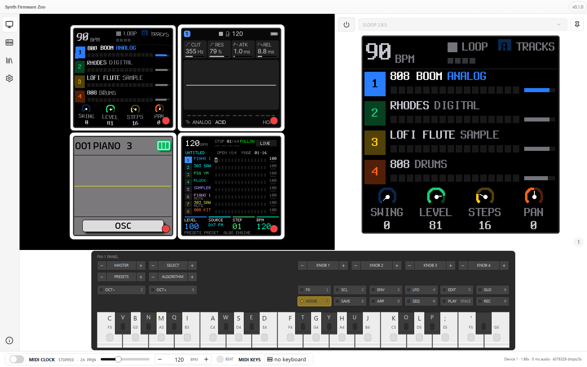
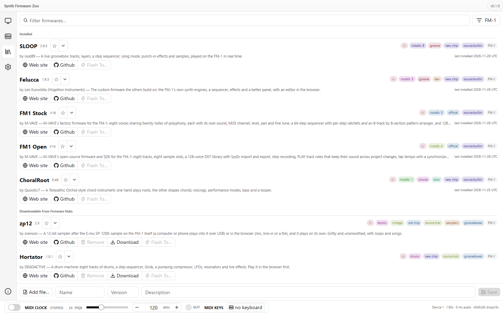
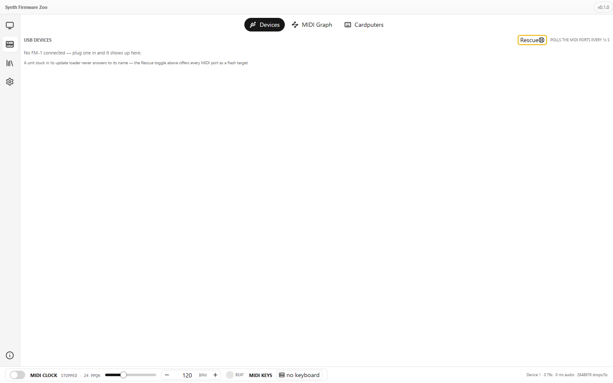
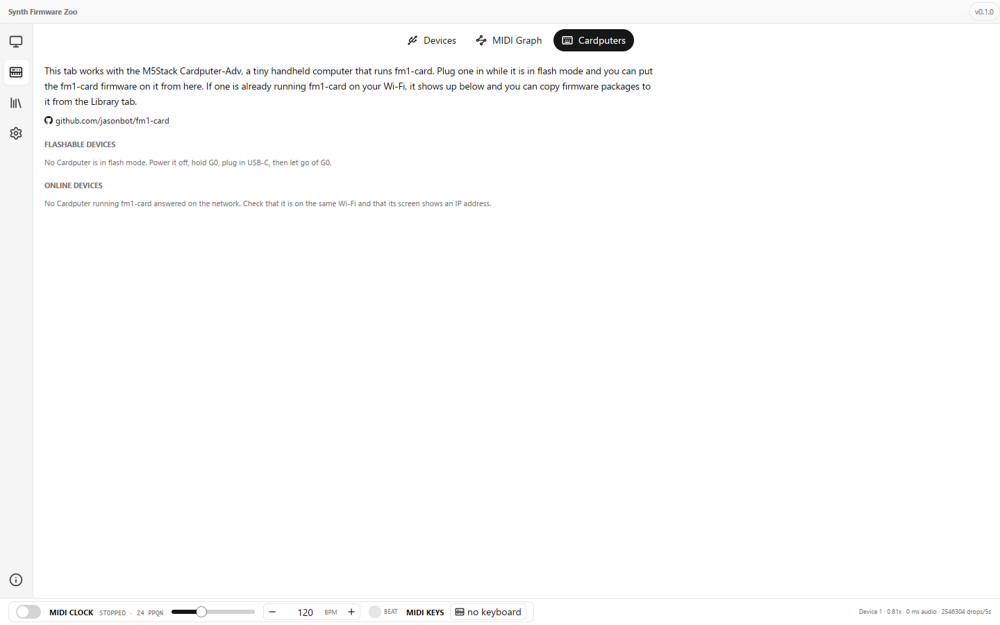
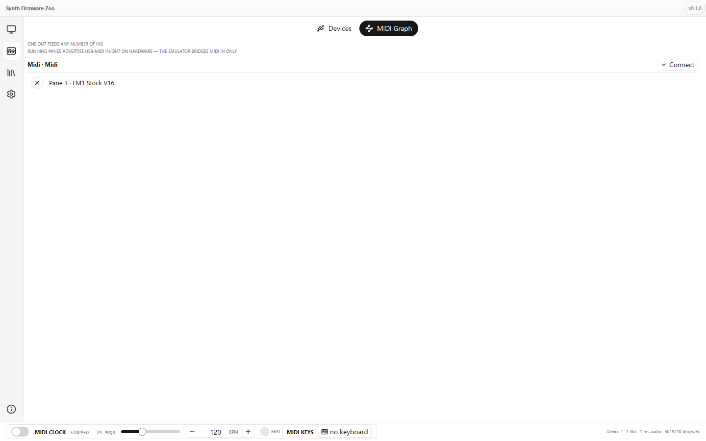
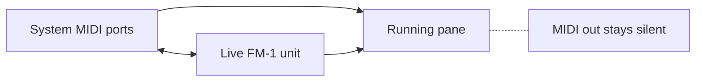
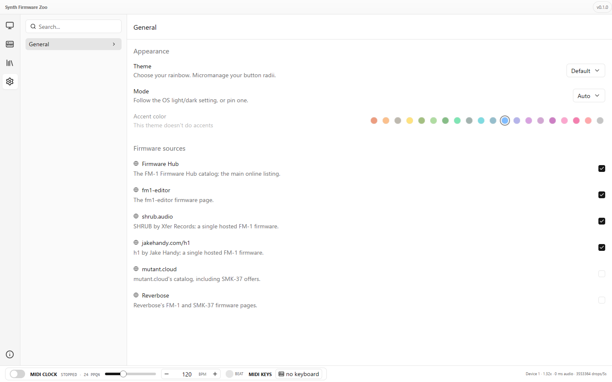
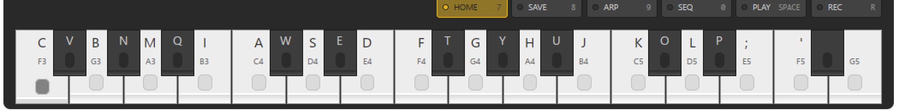

# FM-1 Firmware Zoo


Four M-VAVE FM-1 synths in a 2×2 grid. Each pane has its own firmware and screen.
Built with gpui-kit. The Devices tab also flashes live FM-1 units and SMK-37
units of all types (including the Donner StarryKeys), and copies firmware to
running Cardputers over Wi-Fi.



## Run

```sh
cargo run --release -p fm1-grid
```

- Panes start off. Use the power button in the sidebar to start one.
- Click a pane to select it. Your computer keyboard then plays that pane.
- The sidebar shows the selected pane's screen, firmware picker and pin switch.
- Drag the divider between the grid and sidebar to resize them.
- Pick firmware while the pane is off. It starts the next time you power on.
- Pin a pane to save its flash data. Unpin it to forget the data.
- The app remembers your tabs, theme, split, pane firmware and pin choices.

## Emulator tab

- The grid shows each screen at 1x (240×240). Small windows use 0.5x.
- The selected card gets a slight fisheye bulge. Its screen also shows in the sidebar at 1x, 2x, 3x, 4x or 6x.
- The grid background follows the main color of the selected screen.
- The front panel is a working control surface. Click keys and buttons. Turn knobs with −/+ or the mouse wheel.
- The panel lights follow the firmware and your keyboard.

### Firmware picker

- Pick a firmware for the selected pane from the sidebar.
- The list is searchable and grouped by tag.
- Hover an item to see its description. Bundled items also show the file name and SHA-256 hash.
- The picker only works while the pane is off.
- Add your own file with the Library tab's import form.

The bundled list is in `fm1-firmware/firmware/firmwares.json`. Manage it with:

```sh
scripts/firmware.sh add ~/Downloads/new-1.0.fwsc "New Firmware" 1.0
scripts/firmware.sh del "New Firmware"
scripts/firmware.sh list
```

The `.fwsc` files are gitignored. A fresh build downloads and checks any missing ones.

### Metronome

- Starts off. The switch starts and stops it.
- Sends MIDI clock at 20–300 BPM.
- Drag the slider or use −/+. A typed tempo applies on Enter or focus loss.
- The light blinks on each beat. All running panes follow the clock.

## Library



- Lists bundled firmware, files you import, and online listings.
- Online sources: the FM-1 Firmware Hub, fm1-editor.com, shrub.audio, jakehandy.com/h1, Reverbose and mutant.cloud.
- Search box: all words must match the name, version, tags, author or description.
- Click a tag to add or remove it from the search.
- The **Devices** button shows All, FM-1, **New Chip FM-1**, SMK-37 Pro, SMK-37 Elite or MKE-P37. New Chip FM-1 lists only builds that certify the newer flash chip (or both chips).
- The favorite button pins a row to the top. Its menu gives it a different glyph.
- An `installs: N` tag counts successful installs; the row also shows the last install date. The TUI shows the count in yellow on the right.
- **Download** gets an online firmware. **Download All** gets every offer the device filter shows.
- **Reload** fetches all online lists again.
- **Flash To…** sends a firmware to a live USB unit, an off pane, or a Cardputer on the network. Finished downloads and Cardputer copies show as notifications.
- The bottom form imports a `.fwsc` file with a name, version and description. The package sets the device family and SMK model.

## Devices



- Lists live FM-1 units on USB.
- Each unit has a flash switch and firmware picker.
- Flashing opens the same progress dialog as the Library tab, with a terminal that follows the unit through its reboot.
- **Rescue** adds every MIDI port as a flash target. Use it for a unit that no longer answers to its name. With Rescue on, each live unit also gets **Download mode**, which sends the firmware soft key that restarts it into the chip’s USB download mode.
- The emulator cannot run SMK-37 firmware. Those rows can only go to a live unit.
- A unit in ROM download mode shows its model, firmware and bootloader. With Rescue on, it can take m-bootloader. Download-mode discovery and flashing work on Linux, macOS and Windows; macOS needs sudo and an unmounted unit, and Windows needs administrator access.
- **Back up flash** stores a datestamped, full-flash backup in the app data store; installing m-bootloader, or flashing firmware from either app, also makes one. **Restore backup…** lists backups that match the unit’s model, chip key and flash, and writes the whole flash back.
- With Rescue on, a download-mode unit gets the same searchable firmware combobox as an emulator pane; picking a Library `.fwsc` flashes its application area, keeping the boot area and factory data.
- The newer UC25HQ80 flash (`0xB36014`) does not change the bootloader install: upstream says m-bootloader behaves the same on both flash chips and should work. Back up the full flash before installing it.

### Cardputers



- Open it from the **Cardputers** pill on the Devices tab.
- Lists M5Stack Cardputer-Adv handhelds. The app embeds the fm1-card release image fetched when the embedded image was last refreshed.
- **Flashable devices** are Cardputers in ROM download mode (power off, hold G0, plug in USB-C, release G0). **Flash** writes the whole image and verifies it; power-cycle the device afterwards.
- **Online devices** are Cardputers running fm1-card on your network. Each row shows the card's status from `GET /status` — fm1-card version, Wi-Fi signal, SD state, catalog size and USB device count — and expands to show the firmware packages on its SD card, with the sidecar title, author, version, tags, size and description; that slower detail listing is fetched when a row is expanded, not on every poll.
- The expanded panel adds the card's IP, SSID, clock BPM, local package count and its own flash progress or last failure.
- The app keeps a local card catalog in its data store, seeded from the library's first successful online listing: every entry resolved to a direct `.fwsc` URL. While Cardputers is enabled it gardens that catalog — resolved links are reused, and a small batch of unresolved ones is retried every 30 minutes, so a GitHub rate limit leaves blanks that fill in later instead of forcing a full refresh.
- **Sync catalog** on an online row sends the catalog as it stands (building it once if nothing is cached). The app checks `GET /catalog` first and skips the upload when the card already holds the identical manifest (same SHA-256); the notification names any entries still waiting for a package link.
- The app scans only while the Cardputers section or the Library tab is open, every 5 seconds. It also makes one pass at startup and after an accent change so cards pick up the new color; otherwise it sends no discovery traffic.
- Discovery is off by default. Turn it on from the section's **Enable Cardputers** button or Settings → Cardputers; the pill itself always stays available.
- In the Library, **Flash To…** lists every online Cardputer. It copies the package only when the same bytes are not already there, sending its title, author, version, description and tags so the card shows them; success, already-present and failure each raise a notification.
- While Cardputers is on, the app keeps each card's title-bar accent on your accent color. The card stores an RGB565 copy; the app darkens bright accents so their white title text stays readable.
- Copies to one Cardputer queue up and run one at a time, so the card never handles two requests at once. Each queued copy keeps its notification until its upload finishes; the result replaces it. Package names are reduced to letters, digits, `-`, `_` and `.` so the SD card's FAT32 accepts them.

## MIDI graph



- Open it from the **MIDI Graph** pill on the Devices tab.
- Every MIDI out has its own section. Its sinks are listed under it.
- **Connect** adds a sink. The **X** removes one.
- A running pane can be a sink, but not a source.
- The emulator's MIDI jack is input only. Real FM-1 units also have USB MIDI.



## Settings



- Click the gear in the left rail.
- The search box finds settings by name or keyword.
- **Theme** picks a color set: gpui-kit's Default, BeOS, Hot Dog Stand and the computed accent families.
- **Influenza**, **Meltysand**, **Visualia**, **Mac Platinum**, **Very High Contrast** and **Japanese Stationery** are built from the accent color. Japanese Stationery keeps its paper and ink fixed; its blue family follows the accent.
- **Mode** follows the OS, or pins Light or Dark.
- **Accent color** only works for those computed themes.
- **Firmware sources** turns the Firmware Hub, fm1-editor, shrub.audio, jakehandy.com/h1, mutant.cloud and Reverbose listings on or off. Mutant and Reverbose start off; the others start on.
- **Cardputers** allows the app to look for fm1-card devices on Wi-Fi. It starts off. Turning it off sends no discovery traffic; the Devices → Cardputers section stays available with an enable button.
- **Reset** puts the theme and mode back to their defaults.

## About

- The info icon at the bottom of the rail opens About.
- **About this app** shows the app title, version, release history, and a link to the GitHub repository.
- **Licenses** scrolls the generated third-party licence text.

## Keyboard

Click a pane to send your keys there.

| Keys | FM-1 |
|------|------|
| `A W S E D F T G Y H U J K O L P ; '` | C4 … F5 |
| `C V B N M Q I` | F3 … B3 |
| `Z` / `X` | octave down / up |
| `1`–`0` | function buttons |
| `Space` | PLAY / PAUSE |
| `R` | REC |
| `←` / `→` | PRESETS |
| `↑` / `↓` | ALGORITHM |
| `,` / `.` | SELECT |

- Switching panes releases held keys. A pane that is off ignores keys.
- The front panel keys, buttons and knobs also work with the mouse.
- White keys have a 2px lip and a shaded bottom strip. A pressed key shrinks its strip.
- Keys have a small membrane window near the top. It is slightly shaded when the key is up and glows with the accent when held. Button LEDs use warning yellow, and PLAY uses green.



## fm1-tty

A terminal version for real FM-1 units over USB. It has no emulators.

```sh
cargo run --release -p fm1-tty
```

- **Devices**: live USB units and download-mode units. `R` toggles MIDI rescue mode; `D` switches a live unit into download mode; `f` on a selected library firmware also targets a download-mode unit.
- **MIDI graph**: sources and their sink links. `Enter` removes a link or opens Connect.
- **Library**: the same firmware list. `/` filters, `v` picks a device, `d` downloads, `x` deletes, `a` downloads all, `f` flashes. The flash picker shows each unit’s USB path, any download-mode units, and any fm1-card Cardputers found on the LAN. A Cardputer target copies the package onto its SD card, with the listing’s title, author, version and tags; the card’s own screen flashes the FM-1s it serves. Arrow, Page and Home/End keys in the filter jump back to the list.
- **Metronome**: `Space` starts and stops it. `-`/`+` change the tempo.
- `Tab` moves around. `q` quits. `Ctrl-C` quits from anywhere.
- It shares the library, tempo, device filter and Download All setting with the GUI.

## fm1-remotes

Prints the online firmware catalog as one JSON array on stdout, for hosting as a
feed a small client can consume without the app's download heuristics.

```sh
cargo run --release -p fm1-remotes > firmware.json
```

- The rows are the merged online listing the library shows (Hub, fm1-editor,
  mutant.cloud, Reverbose, shrub.audio, jakehandy.com and the index-only entries),
  with `name`, `version`, `byline`, `description`, `device`, `tags`, `url`,
  `website` and `source_url`.
- `url` is always a direct `.fwsc` package: release and install pages are resolved
  the same way a download is. An entry no `.fwsc` can be found for is omitted
  (and named on stderr), as are embedded firmwares.
- The Hub's failure exits non-zero with no output; a failed additive feed warns on
  stderr and leaves its entries out.

The Cardputers section's **Sync catalog** button sends exactly this feed (with the
card's `GET /catalog` SHA-256 check first) to a connected Cardputer.

## Build

- Needs Rust 1.91 or newer.
- Linux also needs ALSA headers and the usual X11/Wayland dev packages for gpui.
- macOS needs the Xcode command-line tools. Download-mode recovery needs sudo.
- The recovery build downloads m-bootloader v3.0 and its loader from the upstream release, verifies their SHA-256, and keeps them gitignored.
- The Cardputer build downloads the newest fm1-card full-flash image from its GitHub release, verifies it against the release's `SHA256SUMS`, and keeps it gitignored. Delete `fm1-cardputer/data/` to refresh it.
- Windows needs the MSVC build tools. Download-mode recovery needs administrator access.
- Windows MSIX builds: set `FM1_GRID_MSIX_URL` at build time to enable the hosted vanilla-MSIX updater. The URL may point at a `.msix` or an `.msixbundle` (x64 and arm64 packages under one identity). Store installs update through the Store and need no variable.
- macOS app builds: set `MAC_APP_URL` at build time to a JSON feed (`{ "version": "0.2.0", "url": "https://…/FM1-Grid.zip" }`). The zip holds the signed `.app`; the updater swaps it in after quit and reopens it. See `GARDEN-TENDING.md` for the artifact and feed checklist.
- Linux Flatpak builds enable updates inside the sandbox; other Linux builds stay on `Current`.
- `.cargo/config.toml` uses `target-cpu=native`. Delete it when building for another machine.
- The emulator crates are pinned to a revision in `Cargo.toml`. Bump it on purpose.

Cross-build for a DevTerm A04:

```sh
scripts/deploy-devterm.sh
scripts/deploy-devterm.sh fm1-tty
```

The script needs podman. Set `DEVTERM_HOST` or `DEVTERM_PASS` to use another host or a password.

The bundled firmware keeps its own license. See `fm1-firmware/firmware/README.md`.

## Screenshots

```sh
scripts/screenshots.sh
```

This builds the app, then uses Xvfb, xdotool and ImageMagick to capture every image at 1440×900.
Set `FM1_GRID_BIN` to use an existing binary. A missing `/dev/snd/seq` makes the Devices screenshots show a MIDI error.

## Files

- **fm1-base**: clock, routing, key tables and the state store.
- **fm1-firmware**: firmware model, online sources and the library.
- **fm1-hardware**: USB scanner, flasher and rescue.
- **fm1-cardputer**: Cardputer-Adv serial flashing and the fm1-card LAN client.
- **fm1-performer**: emulator, audio, affinity and the shared performer API.
- **fm1-grid-app**: gpui-kit UI and app state.
- **fm1-grid**: the GUI binary.
- **fm1-tty**: the terminal UI.
- **fm1-remotes**: the JSON feed generator for the online firmware catalog.

State lives in the `com.fm1-grid` data directory (`~/.local/share/fm1-grid` on Linux).
