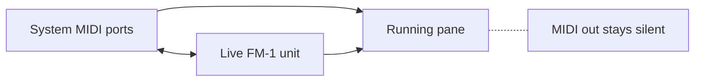

# FM-1 Grid


Four emulated M-VAVE FM-1s in a 2×2 grid, each with its own firmware and screen.
Built with gpui-kit.


Emulators start **off** — flip a pane's power switch in the sidebar to start it.
Click a pane to send your keyboard there; the selected card gets a colored border.

Grid cards show the screens at 1x (240×240), snapping to 0.5x when the window gets
small; the selected card's screen gets a slight fisheye bulge. The selected pane's
screen also appears in the sidebar, hqx-upscaled 2x (4x on big windows), falling
back to nearest-neighbour while the pane's dropout health is orange or worse. The
grid/sidebar split is draggable, with the sidebar kept wide enough for at least 1x.
The grid background follows the main colour of the selected screen (resampled once a
second, faded over 500 ms). The sidebar's firmware selector shows the library entry's
name and version, not the package's file name. The Devices tab has its own pill tabs
on top, centered:
**Devices** (the live USB units) and **MIDI Graph**. The app remembers which one you
picked, like the main tab. Both lists scroll, and PageUp/PageDown/Home/End work
there like they do in the Library.

The large FM-1 front panel at the bottom of the Emulator tab mirrors the active pane:
click its keys and buttons, turn knobs with the −/+ ends, and watch its LEDs follow
the firmware. The computer keyboard plays the pane while that tab shows; a configured
MIDI keyboard forwards on any tab. The keyboard and controls follow the selected
theme: their colors are derived from the theme's background hue (the panel stays
dark, even in a light theme), a held key takes the theme's accent color, and the
button lights take the theme's warning color (success color for PLAY). The panel
tracks the window width both ways and reflows its control groups so they stay clear
of each other.

A running pane can be **pinned** (the toggle beside its firmware selector): its flash
contents — the device's settings and project data — are written to disk at power-off
and when the app quits, and come back at the next boot. Pinned panes restore at
startup (still powered off); unpinning forgets the pane's saved flash. Every pane's
firmware selection and pin restore the same way, and removing a firmware from the
Library powers off the panes set to it and re-seats them with a random available
one. The split position, selected tab (and Devices section), selected pane, theme,
appearance override and accent colour restore the same way. The metronome tempo, the
Library's Download All toggle and device selector are stored once and shared with
fm1-tty, so both apps see the same values. State lives in the com.fm1-grid data
directory (`~/.local/share/fm1-grid` on Linux).

The **Library** tab lists every firmware the app knows — the bundled set, files you
import, and (online) everything the
[FM-1 Firmware Hub](https://thefirmwarehub.com/) offers, downloadable in place. The
listing also folds in [fm1-editor.com's firmware page](https://fm1-editor.com/firmware/),
[Reverbose's FM-1 list](https://reverbose.com/h/m-vave/fm-1),
[Reverbose's SMK-37 list](https://reverbose.com/h/m-vave/smk-37) and
[mutant.cloud](https://mutant.cloud/):
entries the hub lacks appear with their own links, and entries several sites carry get
the combined tags and the newer side's version and download. Two rows count as the
same firmware when their names match after ignoring case and punctuation, or when one
name contains the other, as long as both credit the same author (again ignoring case).
SMK-37 firmware comes from mutant.cloud and Reverbose's SMK-37 list. The hub's own
SMK-37 page only links to each maker's installer, so the app has no package to
download there. Each SMK-37 row carries a tag naming the model it is built for —
`SMK-37 Pro`, `SMK-37 Elite` or `MKE-P37` — and when one firmware ships one package
per model, the model is added to the row's name so the builds stay apart. The Donner
Starrykey 37 Play reports its own model name, but it is the same board as the SMK-37
Pro and runs those packages. Computer-side tools
(programs that run on your computer instead of flashing the hardware) are left out
where a listing labels them: Reverbose's tool cards and mutant.cloud's tools. Each
row has a `source:` tag saying where its download comes from — `builtin`, `hub`,
`fm1-editor`, `reverbose`, `mutant` or `file` — and when a site with a newer version
takes over a row's download, the tag switches to that site. Rows that know their
project's pages get two labelled buttons — **Web site** and **Github** — that open
the project's pages in your browser; a row without those links shows the buttons
greyed out. New rows in the
Installed section pop in with a quick spring animation. The filter box at the
top matches space-separated words, each a case-insensitive substring anywhere in a
firmware's name, version, tags, author or description — "f ll gro" finds Felucca.
Clicking a tag pill toggles that tag's words in the filter. Next to the filter box is
a **Devices** button that picks one device: **All**, **FM-1**, **SMK-37 Pro**,
**SMK-37 Elite** or **MKE-P37**. FM-1 is selected when you start, so the list only
shows what the panes can run; pick a model to see just that build, or All for
everything. The choice is remembered. The emulator cannot run SMK-37 firmware, so
those rows can only be flashed to a live unit, never to a pane. Each
row leads with a favorite button: favoriting is remembered across
restarts, a favorite's pills gain a glyph (`★` by default) and every other row the
hollow `☆`, and the pill filters the list like any tag. The small arrow beside the
favorite button opens a menu that gives the favorite another glyph: `★`, `⮾` (known
as NoThanks), `𓅓` (owl), `𓅃` (falcon) or `𓃱` (giraffe). A favorite with the
NoThanks glyph sorts to the bottom of its section and its row is greyed out, so you can
push a firmware out of the way without forgetting it. Favorite rows float to the top
of their section. The list
draws only the rows on screen, so a big library stays smooth. Items remove (not
builtins), download with progress, and **Flash To…** a live unit (modal progress +
log) or a powered-off unpinned pane (boots it). The **Download All** toggle at the
bottom of the list downloads every offer the device filter shows, including upgrades
of rows the hub has a newer version of (bundled or downloaded); **Reload** beside it re-fetches
all five listings. Download All walks the
list from the top and moves past an item that fails (the item gets one retry when
you flip the toggle off and on, or reload). It is not a poll loop: a sweep runs when
you turn it on, when the online listing refreshes, and when a download finishes,
then it parks. Left on when you quit, it resumes when the app starts and the first
catalog lands. The bottom form imports a firmware file with a name, version and
description; the package's own identity sets the device family and SMK model.


## Run

```sh
cargo run --release -p fm1-grid
```

At startup the panes load the embedded firmwares in list order. Any pane can
run any firmware the library has — pick it from the selector in the sidebar. On Linux
each running emulator is pinned to its own physical core while cores last. Four
emulators at once want four cores; power on only what you play.

### Firmware selector

The power toggle and selector for the selected pane sit in a row across the top of
the sidebar; the selector stretches to fill the row. The power control is a large
toggle button with a power icon. The slot number pill sits on its own at the bottom
right of the sidebar. The pane's status (errors, dropped frames, throughput) is on
the right of the metronome row. The selector only works while the pane is off —
hover it while the pane is on to see why. It is a searchable list of every firmware the
library has at hand — embedded, imported or downloaded — grouped by tag. Hovering a
choice shows its description; embedded entries also show the file name and SHA-256
hash. A new firmware boots the next time you power the pane on. To add a file of your
own, use the Library tab's import form.

The embedded list lives in `firmware/firmwares.json` and is compiled in at build time.
Manage it with the helper script, then rebuild:

```sh
scripts/firmware.sh add ~/Downloads/new-1.0.fwsc "New Firmware" 1.0
scripts/firmware.sh del "New Firmware"
scripts/firmware.sh list
```

`add` copies the package into `firmware/` and records its hash; `del` removes both.
The JSON order is the default pane order.

The `.fwsc` packages are gitignored; the build downloads and hash-verifies any missing
ones on first build, so a fresh clone just works.

## Keyboard

The selected pane gets these keys:

| Keys | FM-1 |
|------|------|
| `A W S E D F T G Y H U J K O L P ; '` | C4 … F5 (key IDs 21–38) |
| `C V B N M Q I` | F3, F#3, G3, G#3, A3, A#3, B3 (IDs 14–20) |
| `Z` / `X` | octave down / up (IDs 0, 1) |
| `1 2 3 4 5 6 7 8 9 0` | function buttons (IDs 2–11) |
| `Space` | PLAY / PAUSE (ID 12) |
| `R` | REC (ID 13) |
| `←` / `→` | PRESETS encoder −/+ |
| `↑` / `↓` | ALGORITHM encoder −/+ |
| `,` / `.` | SELECT encoder |

Switching panes releases held keys on the old one, so no note sticks. A powered-off
pane ignores keys.

## Devices

The Devices tab's first pill lists the live FM-1 units on USB. Each unit gets a big
name line — what it runs, plus the dim port facts — with the flash toggle and
firmware picker on their own row under it. Flash progress pins to the bottom of the
pane while the unit reboots through its loader.

The header's **Rescue** toggle adds every MIDI port on the system as a flash target,
next to the recognized units. That is for a unit so broken it no longer answers to
its FM-1 name (stuck in its update loader). If no FM-1 is found but some MIDI
device is out there, the toggle grows a warning ring.


## MIDI graph

The Devices tab's second pill is the MIDI graph, connecting sources to sinks: system
MIDI ports, running panes and live FM-1 units. Every MIDI out gets its own section,
always shown: the sinks it feeds are listed under its name, each on its own ruled row
with an **X** button at the left that removes the connection, and the section's
**Connect** dropdown routes another sink. A new connection snaps in with a small
spring; a removed one fades away.



A running pane is a sink only. That is the emulator's limit: the FM-1's TRS jack is
MIDI-in alone, and the firmwares' real MIDI path is USB, which the emulated chip
cannot enumerate. The graph says so while such a pane runs.


## Settings

The gear icon at the bottom of the rail opens the Settings tab. It is a searchable
settings page with its own sidebar, like the Settings app on a Mac or iPhone. Under
**General → Appearance** there are three fields: **Theme** — the color scheme:
gpui-kit's Default pair, the bundled sets (BeOS, Hot Dog Stand, Japanese
Stationery and Mac Platinum), plus three computed families: **Influenza**, close to
Windows 11's Fluent UI; **Meltysand**, close to macOS Tahoe's Liquid Glass; and
**Visualia**, a cream (light) / near-black accent (dark) scheme whose front panel is
built from the accent too. All three are built at runtime from the **Accent color**
row of circles (the merged Windows 11 and macOS palette; the macOS value wins where
they overlap) and the **Mode**: Auto (follows the OS), Light or Dark. Every theme also
names an ordered font list: Comic Sans/Chalkboard for Hot Dog Stand, Segoe UI for
Influenza, SF Pro for Meltysand, and so on; the app resolves it to the first family
the machine has. The accent row is enabled only while Influenza, Meltysand or Visualia
is the theme. Picks apply at once and are
saved with the rest of the app state. The page's Reset button puts the theme and mode
back to their defaults. The search box at the top of the sidebar finds settings by
name or keyword ("dark" finds Mode). A dark-only theme keeps the default light side,
and vice versa.


## fm1-tty

A smaller version of the app that runs in a plain terminal. It talks to real FM-1
units over USB and has no emulators — a terminal can't draw their screens. It runs
the same fm1-performer core as the GUI app, so the library and flashing work the same
way. The metronome tempo, the Library's device selector and the Download All toggle
come back after a restart; the clock's run state does not.

```sh
cargo run --release -p fm1-tty
```

fm1-tty is its own crate and doesn't depend on the GUI stack at all: it builds about
150 crates where the GUI app builds about 550, so a clean build is much faster:

```sh
cargo build -p fm1-tty
```

The screen has four parts:

* **Devices** — the live FM-1 units on USB, one row each. `R` toggles **rescue
  mode**: every MIDI port on the system joins the list as a flash target, for a
  unit too broken to answer to its name. If no FM-1 is found but some MIDI device
  is, the block's title warns `R: RESCUE?`.
* **MIDI graph** — the terminal take on the GUI's graph: every MIDI out in the system
  (and every live unit) is a source, with its current links listed under it. One out
  feeds any number of ins. `Tab` into it, move with the arrow keys and press `Enter`
  on a link to unroute it or on `+ connect…` to pick another sink; the same rows are
  mouse-clickable.
* **Library** — the firmware list, same as the GUI's Library tab: what came with the
  app, what you imported, and (online) what the Firmware Hub, fm1-editor.com,
  Reverbose and mutant.cloud offer. Each entry takes two lines: the name, version and
  status on the first, then as much of its description as fits in dim text.
  * `/` focuses the filter box above the list; type any words and every row whose
    name, version, tags, byline or description contains all of them (case-insensitive)
    stays. `Enter` hands the keyboard back to the list; `Esc` clears the filter and
    goes back. `Ctrl-U` clears without leaving the field.
  * `v` opens the **device selector**: one of **All**, **FM-1**, **SMK-37 Pro**,
    **SMK-37 Elite** or **MKE-P37**, exactly like the GUI. Move with the arrows and
    press `Enter`; the field shows the current choice.
  * `r` re-fetches the online listings.
  * `d` downloads the selected firmware. If the hub has a newer version of the
    selected row (marked with `↑`, bundled and downloaded rows alike), `d` upgrades
    it instead, and the hint at the bottom reads `d upgrade`.
  * `x` deletes the selected firmware. Only rows that can leave the library —
    imported files and downloaded packages, never the bundled ones — can be
    deleted, and the hint at the bottom shows `x delete` only for those. Deleting
    a downloaded package throws its download away too; an imported file stays on
    disk.
  * `a` toggles **Download All**: every offer is downloaded in turn, one at a time,
    and rows with a newer version on the hub get upgraded, skipping items that
    fail (flip it off and on to retry them). The title shows `ALL` while it runs.
    It is remembered between runs.
  * `f` flashes it onto a plugged-in unit — an FM-1, an SMK-37, or a Donner
    Starrykey 37 Play, which takes the SMK-37 Pro build — with rescue mode on, onto
    any MIDI port (the picker flags those rows `RESCUE:`). With more than one target
    it asks which one. A pop-up shows progress; on failure it stays up until `Esc`.
* **Metronome** — the same MIDI-clock beat as the GUI. `Space` starts and stops it,
  `-` and `+` nudge the tempo, `[` and `]` jump by ten. The light blinks on every
  beat, and every FM-1 follows the clock.

More keys: `Tab` cycles the library list, the MIDI graph and the filter box; in the
list, the arrow keys (or `j` and `k`) move, `PageUp` and `PageDown` jump ten rows, and
`Home` and `End` go to the ends. `q` quits from the list or the graph; `Ctrl-C` quits
anywhere.

On terminals that support it (Windows Terminal, Ghostty, Konsole, WezTerm, …),
downloads drive the terminal's own progress bar (OSC 9;4) and library additions and
removals raise desktop notifications (OSC 9). Inside tmux these need
`allow-passthrough`.

## Metronome

Starts **off**; the rocker switch starts and stops it. While running it sends a MIDI
clock (24 PPQN) to every emulator, with MIDI Start/Stop on switch on/off. Tempo is
20–300 BPM — the slider beside the field and the −/+ steppers apply at once; a typed
value is free-form while you
edit (a bad draft paints the field's error border) and applies on Enter or when the
field loses focus, clamped into range (unparsable text snaps back to the live tempo).
The slider and the field always show the same tempo: drag one and the other follows.
The small light blinks on every beat.

The clock runs on its own thread, independent of the window's frame rate, so timing
doesn't drift. Audio from all slots is mixed into one output stream; a stalled slot
can't block the others. Each card's status dot reports audio health from the trailing
five seconds of dropouts (green → yellow → orange → red) and hides again a second
after it recovers.

## Building

* Rust 1.91 or newer, stable.
* Linux: ALSA headers (`libasound2-dev` on Debian/Ubuntu) and the usual X11/Wayland
  dev packages for gpui.
* macOS/Windows: just the platform SDK.

`.cargo/config.toml` builds with `target-cpu=native` (this is a local tool) — delete
it if you build for another machine. The emulator crates are pinned to an fm1-emu
revision in `Cargo.toml`; bump the `rev` deliberately.

To build on a fast machine and run it on a DevTerm A04 (aarch64, Cortex-A53):

```sh
scripts/deploy-devterm.sh                  # fm1-grid: cross-build, copy to ~/bin, Xvfb smoke test
scripts/deploy-devterm.sh fm1-tty          # fm1-tty: cross-build, copy to ~/bin, pty smoke test
scripts/deploy-devterm.sh fm1-tty --no-smoke
DEVTERM_HOST=devterm-a04 DEVTERM_PASS=secret scripts/deploy-devterm.sh fm1-tty
```

It needs podman (plus sshpass when `DEVTERM_PASS` is set); it builds the arm64
toolchain container itself.

The firmware images are unmodified packages from
[The FM-1 Firmware Hub](https://thefirmwarehub.com/), M-VAVE and the firmware authors.
They keep their own licences: most are GPL-3.0, M-VAVE's FM1 Stock is Apache-2.0,
FM1 Open adds a linking exception, and Baud Girl (FM-1+VA) is proprietary — its
metadata is bundled but the package itself is not, and the app downloads it from
baudgirl.com on request. The emulator crates are MIT. See
`fm1-firmware/firmware/README.md`.

## Layout

Seven crates in one workspace: **fm1-base** holds the clock, routing, key tables and store;
**fm1-firmware** the firmware model, catalog sources and library; **fm1-hardware** the
USB scanner and flasher; **fm1-performer** the emulator and shared facade both
apps share, **fm1-grid-app** the gpui-kit UI and state, **fm1-grid** its thin binary,
and **fm1-tty** the terminal UI.

```
scripts/firmware.sh             add/del/index/baked/list for the embedded firmware list
fm1-firmware/build.rs           generates the baked and listing-only firmware tables from firmware/firmwares.json
fm1-firmware/firmware/         the embedded .fwsc packages plus firmwares.json
fm1-performer/src/emulator.rs   one thread + SoC + cores per slot, flash snapshot at exit
fm1-performer/src/audio.rs      the per-slot audio queue (the cpal output lives in fm1-grid)
fm1-performer/src/affinity.rs   Linux physical-core detection and per-emulator pinning
fm1-hardware/src/               USB-MIDI scanner, package layout, protocol, flashing, rescue
fm1-performer/src/usbmidi.rs    whether a firmware image advertises USB-MIDI
fm1-base/src/routing.rs         the MIDI graph: sources, sinks, links
fm1-base/src/clock.rs           MIDI-clock thread, tempo, beat light
fm1-base/src/midi_keys.rs       a physical MIDI keyboard driving the virtual one
fm1-firmware/src/library/       firmware library: model, hub fetch/downloads, persistence
fm1-firmware/src/download_heuristics.rs  listing link → package bytes: release/install page resolution, HTML rejection
fm1-performer/src/firmware_picker.rs  what a firmware pick installs or flashes (builtin, file, blob)
fm1-base/src/store.rs           on-disk objects (JSON) and blobs (desktop dir / localStorage)
fm1-firmware/src/builtin.rs     embedded firmware catalogue (generated table)
fm1-base/src/keys.rs            keyboard layout and panel key tables
fm1-grid-app/src/app/           grid state: pane power, firmware install, key routing, LCD upload
fm1-grid-app/src/audio.rs           the four slot queues mixed into one output stream
fm1-grid-app/src/grid.rs            the 2x2 grid of cards (screens snap 1x/0.5x to fit) and the background colour
fm1-grid-app/src/sidebar.rs         the device sidebar: controls row on top, upscaled screen, pin
fm1-grid-app/src/devices.rs         the Devices tab's live USB unit rows and the Rescue toggle
fm1-grid-app/src/graph.rs           the Devices tab's MIDI graph editor
fm1-grid-app/src/panel.rs           the clickable FM-1 front panel (bottom of the Emulator tab)
fm1-grid-app/src/transport.rs       the bottom bar: the metronome row, global across tabs
fm1-grid-app/src/lcd.rs             RGB565 decode, colours, ghost/hqx/nearest image filters
fm1-grid-app/src/theme.rs           the FM-1 hardware colours, the bundled theme catalog; chrome follows gpui-kit
fm1-grid-app/src/themes/            the computed accent families and the shared palette
fm1-grid-app/src/themes/influenza.rs   Fluent-UI family (accent + light/dark)
fm1-grid-app/src/themes/meltysand.rs   macOS Tahoe family (accent + light/dark)
fm1-grid-app/src/themes/visualia.rs    cream/near-black family with an accent-built panel
fm1-grid-app/src/library_tab/   the Library tab's list, pills, actions and add-file form
fm1-grid-app/src/settings.rs        the Settings tab (gpui-kit's Settings component): theme, mode and accent swatches
fm1-grid-app/themes/                the bundled gpui-kit theme sets (upstream themes/ at the pinned tag)
fm1-grid-app/src/firmware_picker.rs the firmware dropdown's data (searchable, grouped by tag)
fm1-grid-app/src/flash_dialog.rs    the modal flash progress + message terminal
fm1-grid-app/src/session.rs         the saved UI state (split, tabs, pane, tempo, Download All)
fm1-grid/src/main.rs            startup and the quit hook saving slot records
fm1-grid-app/src/tests/         headless UI smoke tests
fm1-tty/src/                    the terminal UI (ratatui): library + flashing, MIDI graph, metronome
```
